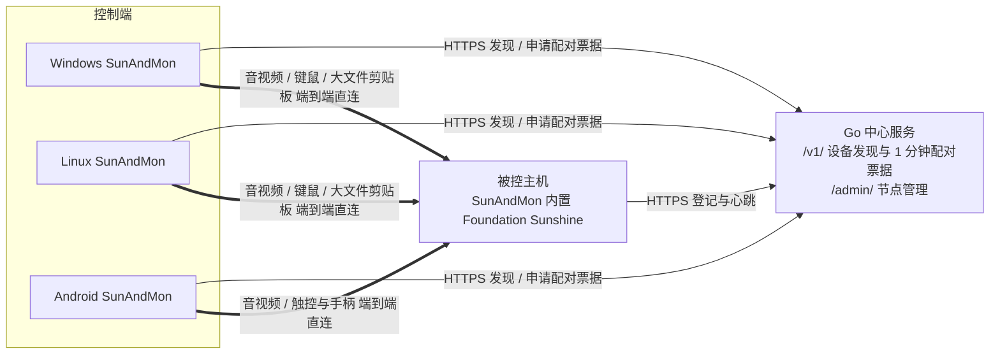

# SunAndMon（日月同辉）

[](https://github.com/Wangbwm/SunAndMon/releases)
[](https://github.com/Wangbwm/SunAndMon/actions/workflows/ci.yml)
[](LICENSE)

**SunAndMon（日月同辉）** 取名自 **Sun**shine（日）与 **Moon**light（月）的融合（为使前后对称将 Moonlight 缩写为 Mon），将 **Moonlight Qt 控制端**与 **Foundation Sunshine 被控引擎**整合进统一的 Windows 免安装包与 Linux 安装包，并配套提供 **Android 控制端**与单进程 **Go 中心服务**。

在同一个窗口内即可查看并连接远端设备，或一键开启本机被控，支持跨网中心自动发现与免 PIN 短期票据配对，音视频与键鼠输入保持端到端直连。

## 平台与功能一览

| 组件 | 产物 | 说明 |
| --- | --- | --- |
| **Windows x64** | `SunAndMon-Windows-x64.zip` | 解压即用，包含 `SunAndMon.exe` 控制端、内置 Sunshine 被控端、大文件分块剪贴板、系统快捷键（如 `Win+R`）、UAC 弹窗捕获、隐私屏与托盘/开机自启管理 |
| **Linux amd64** | `sunandmon_<ver>_amd64.deb` | Ubuntu 24.04 一体包，包含控制端、被控端、桌面图标与 udev 规则；可选配合合盖 1080p 120 Hz 虚拟屏 |
| **Android** | `SunAndMon-Android-<ver>.apk` | 基于 Moonlight V+（`arm64-v8a` / `armeabi-v7a`），新增「我的设备」中心列表、直连 IP、桌面/应用/副屏串流入口，并保留局域网设备页 |
| **中心服务** | `sunandmon-center-*` | 单进程 Go 服务（Linux / Windows），提供设备注册、在线状态同步、1 分钟一次性配对票据签发与 `/admin/` 节点管理后台 |

## 架构简图



> 中心仅负责设备发现与一次性短期配对授权，不中转音视频流与输入数据；设备之间需通过同一局域网、VPN（如 Tailscale / WireGuard / EasyTier）或已映射的公网端口互相可达。

---

## 快速开始

### 1. 部署中心服务

中心是单进程 Go 服务。先生成 32 字节随机密钥并编码为小写十六进制，保存在部署环境的 `SUNANDMON_CENTER_KEY` 中。持有相同密钥的客户端可查看该中心的设备并申请配对，请仅分发给受信任的设备。

```sh
cd center
export SUNANDMON_CENTER_KEY="$(openssl rand -hex 32)"
go run . -listen 127.0.0.1:8787 -state state/devices.json
```

也可以直接从 [Releases](https://github.com/Wangbwm/SunAndMon/releases) 下载预编译的中心二进制（Linux 使用 `sunandmon-center-linux-amd64`，Windows 使用 `sunandmon-center-windows-amd64.exe`）。

- **HTTPS 部署**：跨设备访问时，建议在服务前配置 HTTPS 反向代理并转发到 `127.0.0.1:8787`，或直接使用 `-listen :8787 -tls-cert fullchain.pem -tls-key privkey.pem` 提供 HTTPS。本机调试可使用 `http://127.0.0.1:8787`。
- **直连 IP 访问 HTTPS 中心**：Windows 与 Android 客户端均支持在「中心服务器」中填写证书对应的 HTTPS 网址，并在「直连 IP」填入服务器数字 IP；客户端会直连该 IP，同时严格按网址中的域名校验 TLS 证书。留空则走常规 DNS 解析。

### 2. 节点管理后台（可选）

在中心服务部署环境中配置独立的管理员密钥 `SUNANDMON_CENTER_ADMIN_KEY`（同样可用 `openssl rand -hex 32` 生成）并重启中心。使用反向代理时需同时转发 `/v1/` 与 `/admin/`。

打开中心网址下的 `/admin/`，或在 Windows 客户端点击「中心服务器 → 管理节点」即可：
- 查看所有登记记录（含普通列表隐藏的重复记录）；
- 覆盖节点的显示名称、连接 IP 与 HTTP/HTTPS 端口（留空则跟随主机上报）；
- 删除节点并禁止原设备 ID 再次登记，直到管理员显式选择「允许重新登记」。

### 3. 使用桌面端与移动端

- **Windows**：下载并解压 `SunAndMon-Windows-x64.zip` 到任意目录（保留内部 `host` 目录），运行 `SunAndMon.exe`。用户配置（中心网址、直连 IP、加密保存的密钥、已配对主机与串流设置）默认保存在 `%APPDATA%\SunAndMon\SunAndMon.ini`，内置被控配置保存在 `%APPDATA%\SunAndMon\host\`，删掉程序目录更新版本不会丢失数据（如需随身便携模式，可将程序目录内的 `portable.dat.inactive` 改名为 `portable.dat`）。左下角打开「中心服务器」填写 HTTPS URL 与密钥后，本机被控会自动登记；在设备页选中在线主机点「连接桌面」即可由中心自动授权，无需输入 PIN。
  - 在「本机被控」中可开关「登录 Windows 时自动启动」、指定「发布 IP」或打开 Sunshine 原有控制面板（「主机设置」）。
  - **Windows 登录前被控**：使用安装版，先登录 HTTPS 中心并启用「允许远程操作 UAC 弹窗（系统服务）」。关闭当前被控后，在「本机被控」打开「允许在 Windows 登录前远控」并确认管理员提示。系统服务使用独立的 Sunshine 配置和设备身份。请在另一台设备的中心列表确认该主机在线，使用局域网或系统 VPN 线路，从中心连接并在 Windows 登录界面输入密码。此模式暂不接管内置隧道和剪贴板；关闭该选项可恢复应用管理的模式。
  - 在「设置 → 软件 → 关闭按钮行为」中可选择确认退出或最小化到托盘。
  - 串流期间可在「控制中心 → 视频和显示」切换**隐私屏**（被控端需新版 SunAndMon、ZakoVDD 虚拟显示器与虚拟音频设备如 Steam Streaming Speakers 或 VB-CABLE）。
- **Linux（Ubuntu 24.04）**：下载 `sunandmon_<ver>_amd64.deb` 后执行 `sudo apt install ./sunandmon_<ver>_amd64.deb` 安装，即可从应用菜单或命令行 `sunandmon` 启动。
- **Android**：安装 `SunAndMon-Android-<ver>.apk`。在「我的设备」打开「中心服务器」登录，点击在线电脑进入详情页即可一键连接桌面、打开应用列表、开启副屏串流或执行电源操作；「局域网设备」保留原 Moonlight 局域网发现与 PIN 配对入口。

---

## Linux 虚拟显示器（可选）

`scripts/linux/virtual-display/` 提供合盖场景下的 1080p 120 Hz 虚拟屏配置，利用 Intel `i915` 的空闲 `HDMI-A-1` 供桌面和 Sunshine KMS 捕获使用（仅适用于具备该输出且 HDMI 未接物理显示器的机器）：

```sh
cd scripts/linux/virtual-display
sudo install -D -m 0644 virtual-1080p.edid /usr/local/share/sunandmon/virtual-1080p.edid
sudo install -D -m 0755 sunandmon-virtual-display /usr/local/libexec/sunandmon-virtual-display
sudo install -D -m 0644 sunandmon-virtual-display.service /etc/systemd/system/sunandmon-virtual-display.service
sudo systemctl daemon-reload
sudo systemctl enable --now sunandmon-virtual-display.service
```

---

## 从源码构建与自动化发版

### 本地构建

首次克隆仓库后先初始化子模块：

```sh
git submodule update --init --recursive
```

- **中心服务**：`cd center && go test -race ./... && go build .`
- **Linux `.deb`（Ubuntu 24.04）**：准备好 Sunshine Web UI 目录后运行 `SUNANDMON_VERSION=1.0.2 SUNANDMON_WEB_ASSETS_DIR=/path/to/assets/web bash scripts/build-linux.sh`
- **Windows x64 便携包**：分别以 `CONFIG+=release CONFIG+=sunandmon` 编译 `moonlight-qt` 并编译 `foundation-sunshine` 便携包后，执行：
  ```sh
  python scripts/package-windows.py Moonlight-SunAndMon-Portable-x64.zip Sunshine-Portable-x64.zip SunAndMon-Windows-x64.zip
  ```
- **Android APK**：进入 `moonlight-vplus/`，配置 `AUDIO_HAPTICS_SDK_DIR` 指向 `AlkaidLab/moonlight-audio-haptics` 检出目录后执行 `./gradlew :app:assembleNonRootDebug`（或配置签名变量后执行 `:app:assembleNonRootRelease`）。

### GitHub Actions 自动 CI 与全平台 Release

仓库已配置两套工作流：

- **[CI](.github/workflows/ci.yml)**：每次 Push / PR 到 `main` 自动执行 Go 中心单测与交叉编译、开源合规文件检查、脚本语法校验及密钥泄露审计。
- **[Build & Release](.github/workflows/release.yml)**：推送 `v*` 标签（如 `git tag v1.0.2 && git push origin v1.0.2`）或通过 Actions 页面手动触发时，自动并行构建：
  1. Linux / Windows 中心二进制
  2. Sunshine Web UI（共享给 Linux 与 Windows 作业复用）
  3. Ubuntu 24.04 `.deb` 安装包
  4. Android APK（若在仓库 Secrets 中配置了 `ANDROID_KEYSTORE_BASE64`、`ANDROID_KEYSTORE_PASSWORD`、`ANDROID_KEY_ALIAS`、`ANDROID_KEY_PASSWORD`，自动产出正式签名 Release APK；未配置时自动回退为签名 Debug APK）
  5. Windows x64 一体便携 ZIP
  6. 汇总生成 `SHA256SUMS.txt` 并发布到对应 Tag 的 GitHub Release。

---

## 常见问题排查

- **配对票据过期或时间不同步**：中心签发的配对票据有效期为 1 分钟；被控端验票容忍前后 30 分钟时钟偏差，每张票据仅可使用一次。若仍提示无效，请确认控制端、中心与被控端系统时间已开启 NTP 同步。
- **远端无法直连**：请确认两端处于同一局域网/组网（如 Tailscale/EasyTier）或主机已正确转发 Sunshine 端口，并可在主机端「本机被控 → 发布 IP」显式指定希望对外公布的网卡或组网 IP。
- **撤销旧设备授权**：中心删除节点仅禁止该设备重新登记；若需撤销已完成配对的某台控制端，请在对应被控主机的「主机设置」中移除该客户端。

## 目录结构

- `foundation-sunshine/` — 被控端串流引擎、被控进程生命周期与客户端证书配对
- `moonlight-qt/` — Windows / Linux 控制端界面、中心登录、本机被控管理与串流启动
- `moonlight-vplus/` — Android 控制端中心设备入口、统一图标与串流启动
- `center/` — Go 中心服务（设备注册表、在线状态、短时配对授权与 `/admin/` 后台）
- `scripts/` — Windows / Linux 构建打包、虚拟显示器配置与仓库同步脚本
- `.github/workflows/` — 自动化 CI 检验与多平台 Release 发布工作流

## 开源协议与致谢

本项目以 **GNU General Public License v3.0（GPL-3.0）** 开源发布，详见 [LICENSE](LICENSE)。

有关上游项目归属（[Foundation Sunshine](https://github.com/AlkaidLab/foundation-sunshine)、[Moonlight Qt](https://github.com/qiin2333/moonlight-qt)、[Moonlight V+](https://github.com/qiin2333/moonlight-vplus)、[moonlight-audio-haptics](https://github.com/AlkaidLab/moonlight-audio-haptics)）、改动摘要及第三方组件许可，请参阅 [NOTICE](NOTICE)；安全模型与漏洞反馈请参阅 [SECURITY.md](SECURITY.md)。

## 上游基线

- `foundation-sunshine/` 基于 `7f7630f61c5b6db09ca9a6931586bcffa03ce263`。
- `moonlight-qt/` 基于 `490923396a0bc53350dfadf88d5cf39bc9a39362`。
- `moonlight-vplus/` 基于 `484532dc38775b5d2763a4609e622a50b3dc986a`。
